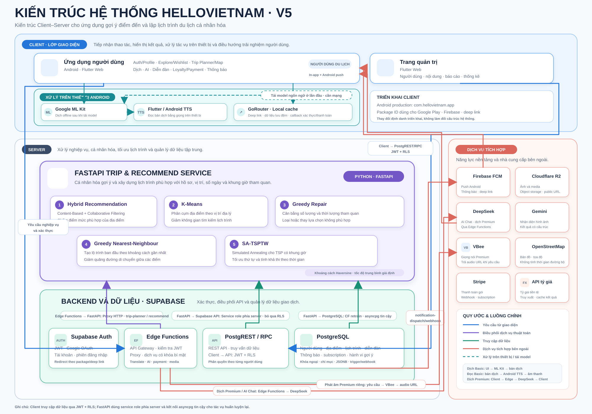

# Hello Vietnam

A team-built travel application for exploring destinations in Vietnam, planning trips, and discovering travel information. The project combines a Flutter user app and web admin interface with Supabase services and a Python recommendation and trip-planning service.

> **Portfolio snapshot:** This repository is a public snapshot of a collaborative project, published by [Novem07](https://github.com/Novem07). The original team repository is private, so its commit history is not included here. The contributions below are based on commits authored by Novem07 in the original `final` branch; other contributors also built and integrated parts of the project.

## Features

- Explore destinations and travel content, with recommendations and trip planning.
- Use AI-powered travel chat and image recognition to support travel discovery.
- Share a trip through a public link and view it on the web.
- Report potentially outdated place information and review data freshness in the admin interface.
- Manage a premium subscription using a Stripe sandbox checkout flow.

## My contributions

Commit history attributes the following work to **Novem07**, alongside contributions and integration work from the rest of the team:

- **AI travel features:** implemented the premium AI chat flow and travel-aware image recognition, including result handling and recognition history.
- **Trip planning and sharing:** integrated the trip-planning service and implemented share links, a public web viewer, and deep-link handling.
- **Data freshness:** built a workflow for checking source data, user reports, and admin review, with supporting tests and operational documentation.
- **Place content:** implemented source collection, generation and validation of bilingual place descriptions, and reviewable application of content batches.
- **Payments and premium access:** worked on Stripe sandbox checkout, webhook-based payment finalization, and shared premium entitlement state.
- **Integration and delivery:** improved home recommendations and data loading, added currency-rate support, and helped consolidate and document the final demo workspace.

These descriptions identify contributions reflected in authored commits; they do not imply sole ownership of the broader features.

## Architecture and technology

Flutter / Dart ? Supabase (PostgreSQL and Edge Functions) ? TypeScript / Deno ? Python / FastAPI ? Stripe sandbox



The diagram is included as project documentation; external services and credentials must be configured separately to run the complete system.

## Supported targets

- Android user: `frontend/lib/main.dart`
- Web user: `frontend/lib/main.dart`
- Web admin: `frontend/lib/main_admin.dart`

This snapshot excludes iOS and desktop scaffolding. It was taken from the original project?s `final` branch; other branches and the original commit history are not included here.

## Repository layout

- `frontend/`: Flutter source, Android/Web scaffolding, assets, tests
- `backend/supabase/`: canonical Edge Functions, migrations, SQL tests
- `backend/crawldata/`: active crawler and cached demo fallback
- `cf_service/`: FastAPI recommendation and trip-planning service
- `trip-share-web/`: public static trip viewer
- `scripts/`: repeatable demo scripts
- `docs/`: current runbooks, architecture, evidence, cleanup report
- `evaluation/ai_quality/`: reproducible AI evaluation code and datasets

## Flutter

```powershell
cd frontend
flutter pub get --enforce-lockfile
flutter run -d chrome --target lib/main.dart --web-port 3000
```

Web admin:

```powershell
cd frontend
flutter run -d chrome --target lib/main_admin.dart --web-port 3001
```

Android user:

```powershell
cd frontend
flutter run --target lib/main.dart
```

VS Code provides `User`, `Admin`, `User Mobile`, and `User + Admin`. Android
push notifications require local file
`frontend/android/app/google-services.json`; never commit it.

## FastAPI service

```powershell
cd cf_service
python -m venv .venv
./.venv/Scripts/python.exe -m pip install -r requirements.txt
Copy-Item .env.example .env
./.venv/Scripts/python.exe -m uvicorn main:app --reload --port 8000
```

Populate `.env` locally. Never put a service-role key or database password in
Flutter, Git, screenshots, or documentation.

## Supabase

The canonical Supabase working directory is `backend`:

```powershell
cd backend
npm ci
npx supabase migration list --linked
npx supabase functions deploy trip-planner
```

Database migrations are applied only during an explicitly approved deployment.

## Data freshness demo

```powershell
Set-ExecutionPolicy -Scope Process Bypass
./scripts/data-freshness-demo.ps1 -Mode preflight
./scripts/data-freshness-demo.ps1 -Mode crawler -Limit 5
./scripts/data-freshness-demo.ps1 -Mode checker -CheckerBatchSize 5 -SupabaseUrl $env:SUPABASE_URL
```

Checker mode also requires process variable `DATA_FRESHNESS_CHECK_SECRET`. The
script never prints it. See `docs/data-freshness-demo-runbook.md`.

## Trip sharing

`trip-share-web/` is a dependency-free Cloudflare Pages output directory. Set
its public Function URL in `trip-share-web/config.js`.

## Verification

```powershell
cd frontend
flutter analyze --no-fatal-infos
flutter test --reporter compact

cd ../cf_service
./.venv/Scripts/python.exe -m compileall -q .
./.venv/Scripts/python.exe -m unittest discover -s . -p 'test_*.py' -v
```

See `docs/final-cleanup-report.md` for all checks and known baseline debt.
